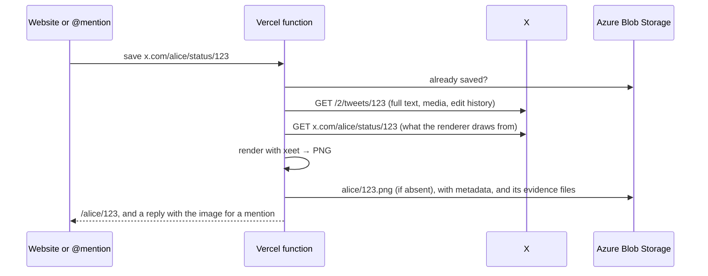

# xposts

A public archive of X posts, in the spirit of web.archive.org: give it a post, and it keeps a
pixel-accurate image of it and the data X returned for it, in public storage whose own
timestamps show when the save was made.

- **Save a post** on the website (sign-in required), or reply to any post mentioning
  `@SaveXPosts`: the bot answers with the image and the link.
- **A post is saved once.** The first save stands and is never rendered or written again.
- **Addresses mirror x.com**, so swapping the host of a post link works:

  | Address | What it is |
  | --- | --- |
  | `/<username>` | Every saved post of that author |
  | `/<username>/<post id>` | The page of one save: image, text, proof (`/<username>/status/<post id>` redirects here) |
  | `/s/<username>/<post id>` | Permanent redirect to the image itself, for embedding and hot-linking |

## How a post is saved



1. **Read.** The post is read from the X API v2 with the same request as
   [kzu/xurl](https://github.com/kzu/xurl)'s `read` command, which returns the complete text of
   long posts (`note_tweet`), articles and media. The text of a save is always the API's.
2. **Render.** [xeet](https://github.com/rauchg/xeet) draws the post the way x.com does, in
   WebAssembly, without a browser. It resolves the post from its x.com page; if X does not serve
   the page, or the page disagrees with the API on the text, the post is drawn from the API
   response instead, and the record says so.
3. **Store.** The files of a save sit next to each other in a container anyone can read and list:

   | Blob | What it is |
   | --- | --- |
   | `<username>/<post id>.png` | The rendered post. Its blob metadata describes the save |
   | `<username>/<post id>.json` | The record: the whole text, hashes of the other files, what X stated |
   | `<username>/<post id>.x-api.json` | The X API response body, byte for byte |
   | `<username>/<post id>.xeet-input.json` | The exact renderer input and options |

## The proof of date

The image is written to Azure Blob Storage with a condition that refuses to replace an existing
blob. Azure, not the archive, then sets and publishes these properties of the blob:

```console
$ curl -I https://xposts.blob.core.windows.net/saves/rauchg/2122184794209714368.png
x-ms-creation-time: Mon, 16 Nov 2026 14:26:48 GMT
Last-Modified: Mon, 16 Nov 2026 14:26:48 GMT
ETag: "0x8DF43EDA6414C87"
Content-MD5: KTI87iyhtW9WMF4mR8HoPA==
x-ms-meta-sha256: 3c36dcab70b6fd372974aca7b9bdc77cb31d0a8ffaaf358b8ec336e3fce57034
x-ms-meta-postid: 2122184794209714368
…
```

- `x-ms-creation-time` is when the save was made. `Last-Modified` equals it for a blob that was
  never rewritten.
- `Content-MD5` is Azure's own checksum of the bytes it holds; `x-ms-meta-sha256` is the
  archive's. Hash the image you downloaded (`sha256sum`, or drop it on `/verify`, which hashes
  it in your browser) and compare.
- The image is what the stored data renders to. xeet is deterministic: rendering
  `…xeet-input.json` with the `@xeet/core` version it names gives the same bytes.

  ```js
  import { loadXeet } from "@xeet/core/node";
  const { post, options } = JSON.parse(fs.readFileSync("xeet-input.json", "utf8"));
  const { png } = (await loadXeet()).render(post, options); // same SHA-256 as the saved image
  ```

### What a save proves, and what it does not

X does not sign posts, so no archive can prove cryptographically that X served a given post.
A save shows that this archive stored these exact bytes at the time Azure states. That rests on
Microsoft's clock, and on the archive's operator not having deleted a blob and created it again:
a storage account owner can do that, and the new blob would carry the later date, never an
earlier one. What the archive preserves of X's own account of the post is in the record's
`fingerprint`: the creation time encoded in the post id, the `created_at` the API stated and
whether both agree, the edit history, and the response headers that identify the API request on
X's side. Because the code is open and rendering is reproducible, anyone can check that a save
is what this code produces from the stored data.

## Architecture

One Vercel function ([api/index.js](api/index.js)) serves everything, from a bundle that
`npm run build` makes of [src/main.ts](src/main.ts); Azure Blob Storage is the only store.

| Part | Code |
| --- | --- |
| Website | [src/web](src/web) |
| Sign-in with Auth0 | [src/auth](src/auth) |
| Saving a post | [src/capture.ts](src/capture.ts) |
| Storage: saves as blobs, found by prefix, by index tag, by hash | [src/azure.ts](src/azure.ts) |
| Rendering | [src/render/xeet.ts](src/render/xeet.ts) |
| X API: reading posts, mentions, replies | [src/x](src/x) |
| Answering mentions | [src/mentions.ts](src/mentions.ts), called by [a scheduled workflow](.github/workflows/mentions.yml) |

The top-level names `about`, `verify`, `submit`, `api`, `auth` and `s` belong to the site: the
saved posts of an X account with one of those handles are reachable through `/s/` only.

## Running it locally

```sh
npm install
cp .env.example .env.local   # fill in what you have
npm run dev                  # http://localhost:3000
npm test
```

Only the storage connection string is required. Without X API credentials a post is saved from
its x.com page alone; without Auth0 nobody can sign in, so nothing can be submitted from the
website.

## Deploying

```sh
# Storage: a resource group, an account that allows public blobs, a public and a private container.
az group create --name xposts --location eastus
az storage account create --name <account> --resource-group xposts --sku Standard_LRS \
  --kind StorageV2 --allow-blob-public-access true --min-tls-version TLS1_2
az storage container create --name saves --public-access container --account-name <account>
az storage container create --name state --account-name <account>
# So that anonymous requests show x-ms-creation-time:
az storage account blob-service-properties update --account-name <account> \
  --resource-group xposts --default-service-version 2023-11-03

# The site
vercel link
vercel git connect
vercel env add <NAME> production   # for each setting below
vercel deploy --prod
```

| Setting | Where it comes from |
| --- | --- |
| `AZURE_STORAGE_CONNECTION_STRING` | `az storage account show-connection-string --name <account>` |
| `PUBLIC_URL` | The site's address, when it is not the Vercel production domain |
| `AUTH0_DOMAIN`, `AUTH0_CLIENT_ID`, `AUTH0_CLIENT_SECRET` | An Auth0 "Regular Web Application". Allowed callback URL: `<PUBLIC_URL>/auth/callback`; allowed logout URL: `<PUBLIC_URL>` |
| `SESSION_SECRET` | Any long random string (`openssl rand -base64 48`) |
| `X_BEARER_TOKEN` | The app-only bearer token of an X developer app: reads posts |
| `X_API_KEY`, `X_API_SECRET`, `X_ACCESS_TOKEN`, `X_ACCESS_SECRET` | OAuth 1.0a keys of the same app and access tokens of the bot account, with read and write permission: reads mentions, posts replies |
| `X_BOT_USER_ID`, `X_BOT_HANDLE` | The numeric user id and the handle of the bot account |
| `CRON_SECRET` | Any long random string. Also set it, with `XPOSTS_URL`, as a secret of the GitHub repository: the [mentions workflow](.github/workflows/mentions.yml) calls `/api/cron/mentions` with it every five minutes |

## Credits

- [xeet](https://github.com/rauchg/xeet) by Guillermo Rauch renders the posts (Apache-2.0).
- [xurl](https://github.com/xdevplatform/xurl), through the [kzu/xurl](https://github.com/kzu/xurl)
  fork, defines the X API request that returns a post's complete text.

## License

[MIT](LICENSE)
