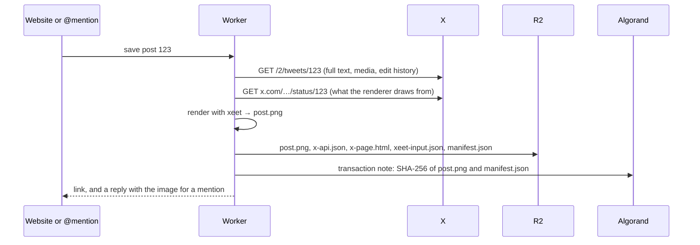

# xposts

A public archive of X posts, in the spirit of web.archive.org: give it a post, and it keeps a
pixel-accurate image of it, the data X returned for it, and a proof on a public blockchain that
the image existed with exactly those bytes at that time.

- **Save a post** on the website (sign-in required), or reply to any post mentioning
  `@SaveXPosts`: the bot answers with the image and the link.
- **Every capture is permanent and addressable**: `/p/<post id>/<YYYYMMDDHHmmss>`, with every
  capture of a post listed at `/p/<post id>`.
- **Every capture is verifiable** without trusting this archive: its hashes are written to
  Algorand, and its image can be rendered again from the stored input.

## How a capture is taken



1. **Read.** The post is read from the X API v2 with the same request as
   [kzu/xurl](https://github.com/kzu/xurl)'s `read` command, which returns the complete text of
   long posts (`note_tweet`), articles and media. The text of a capture is always the API's.
2. **Render.** [xeet](https://github.com/rauchg/xeet) draws the post the way x.com does, in
   WebAssembly, without a browser. It resolves the post from its x.com page; if X does not serve
   the page, or the page disagrees with the API on the text, the post is drawn from the API
   response instead, and the manifest says so.
3. **Store.** Each capture keeps these files:

   | File | What it is |
   | --- | --- |
   | `post.png` | The rendered post |
   | `x-api.json` | The X API response body, byte for byte |
   | `x-api-headers.json` | The response headers of that request |
   | `x-page.html` | The x.com page the renderer read |
   | `xeet-input.json` | The exact renderer input and options |
   | `manifest.json` | SHA-256 of every file above, and what is known about the capture |

4. **Anchor.** A zero-amount Algorand transaction from the archive's account carries a note with
   the SHA-256 of `post.png` and of `manifest.json`. The block it lands in dates the capture.

## Verifying a capture yourself

- **The image is the one that was anchored.** Compute the SHA-256 of the PNG
  (`sha256sum post.png`, or drop it on `/verify`, which hashes it in your browser). Open the
  capture's Algorand transaction in any explorer and read its note: `xposts/v1:j{…}` holds the
  same hash, and the block time shows when. Nobody, including the archive, can change that note
  or backdate it.
- **The image is what the stored data renders to.** xeet is deterministic: rendering
  `xeet-input.json` with the `@xeet/core` version it names gives the same bytes.

  ```js
  import { loadXeet } from "@xeet/core/node";
  const { post, options } = JSON.parse(fs.readFileSync("xeet-input.json", "utf8"));
  const { png } = (await loadXeet()).render(post, options); // sha256(png) === the anchored hash
  ```
- **The data is what the manifest says.** `manifest.json` lists the SHA-256 of every stored
  file, and its own hash is in the same transaction note.

### What a capture proves, and what it does not

X does not sign posts, so no archive can prove cryptographically that X served a given post.
A capture proves that this archive held these exact bytes no later than the block time of its
anchor. What the archive preserves of X's own account of the post is in the manifest's
`fingerprint`: the creation time encoded in the post id, the `created_at` the API stated and
whether both agree, the edit history, and the response headers that identify the API request on
X's side. Because the code is open and rendering is reproducible, anyone can check that a
capture is what this code produces from the stored data.

## Architecture

One Cloudflare Worker ([src/index.ts](src/index.ts)):

| Part | Cloudflare product | Code |
| --- | --- | --- |
| Website, API, stored files | Workers, Hono | [src/web](src/web), [src/api.ts](src/api.ts) |
| Sign-in | Auth0 | [src/auth](src/auth) |
| Capture index | D1 | [src/db.ts](src/db.ts), [migrations](migrations) |
| Capture files | R2 | [src/storage.ts](src/storage.ts) |
| Capture jobs, with retries | Queues | [src/pipeline.ts](src/pipeline.ts) |
| Mentions of the bot | Cron Triggers | [src/mentions.ts](src/mentions.ts), [src/x](src/x) |
| Rendering | WebAssembly, static assets for fonts | [src/render/xeet.ts](src/render/xeet.ts) |
| Anchoring | Algorand | [src/chain](src/chain) |

## Running it locally

```sh
npm install                 # also prepares xeet for Workers (scripts/prepare-xeet.mjs)
npm run db:migrate:local
cp .dev.vars.example .dev.vars   # fill in what you have; every integration is optional
npm run dev
npm test
```

Without X API credentials a capture is taken from the x.com page alone; without an Algorand
mnemonic it is stored but not anchored; without Auth0 nobody can sign in, so nothing can be
submitted from the website.

## Deploying

The Worker needs the Workers Paid plan: the xeet module alone is 2.9 MB compressed, over the
free plan's limit.

```sh
npx wrangler d1 create xposts            # put the id it prints in wrangler.jsonc
npx wrangler r2 bucket create xposts
npx wrangler queues create xposts-archive
npx wrangler queues create xposts-archive-dlq
npm run db:migrate
npx wrangler secret put <NAME>           # for each secret below
npm run deploy
```

Set `PUBLIC_URL`, `REPO_URL`, `X_BOT_HANDLE` and `ALGORAND_NETWORK` in `wrangler.jsonc`.

| Secret | Where it comes from |
| --- | --- |
| `AUTH0_DOMAIN`, `AUTH0_CLIENT_ID`, `AUTH0_CLIENT_SECRET` | An Auth0 "Regular Web Application". Allowed callback URL: `<PUBLIC_URL>/auth/callback`; allowed logout URL: `<PUBLIC_URL>` |
| `SESSION_SECRET` | Any long random string (`openssl rand -base64 48`) |
| `X_BEARER_TOKEN` | The app-only bearer token of an X developer app: reads posts |
| `X_API_KEY`, `X_API_SECRET`, `X_ACCESS_TOKEN`, `X_ACCESS_SECRET` | OAuth 1.0a keys of the same app and access tokens of the bot account, with read and write permission: reads mentions, posts replies |
| `X_BOT_USER_ID` | The numeric user id of the bot account |
| `ALGORAND_MNEMONIC` | The 25 words of the archive's Algorand account. Fund it: each capture costs the minimum fee, 0.001 ALGO |

## Credits

- [xeet](https://github.com/rauchg/xeet) by Guillermo Rauch renders the posts (Apache-2.0).
  Its font packs are not part of this repository; `npm install` copies them from `@xeet/core`.
- [xurl](https://github.com/xdevplatform/xurl), through the [kzu/xurl](https://github.com/kzu/xurl)
  fork, defines the X API request that returns a post's complete text.

## License

[MIT](LICENSE)
